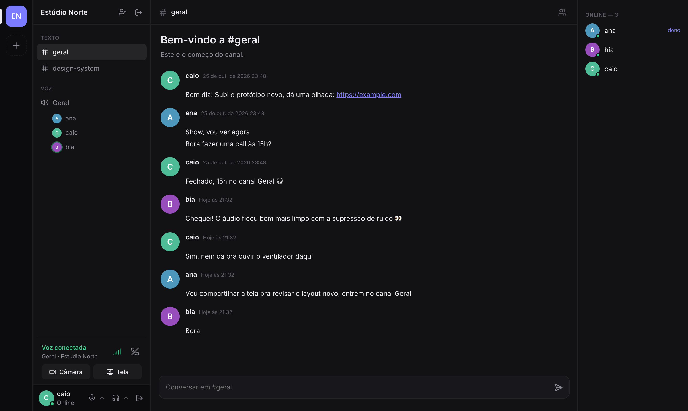
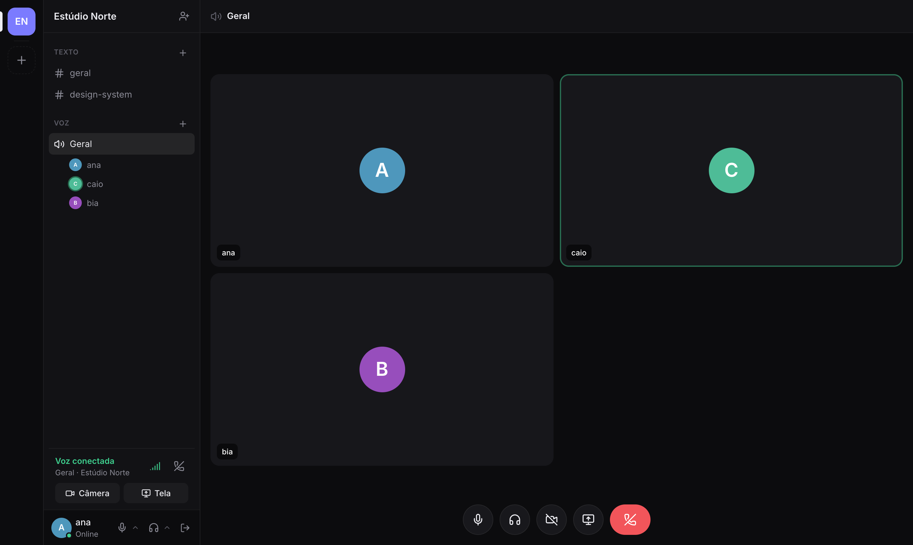
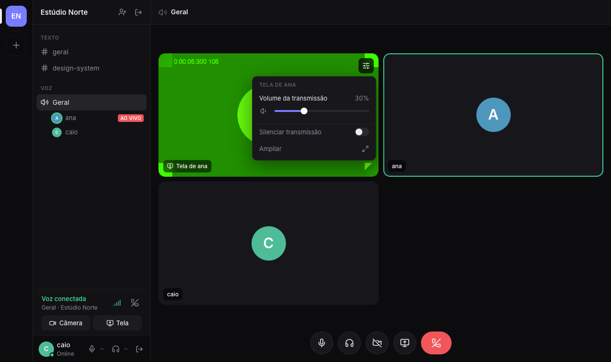

<p align="center">
  
</p>

<h1 align="center">Discordia</h1>

<p align="center">
  <strong>Grupos, chat, voz, câmera e compartilhamento de tela no seu próprio servidor.</strong><br>
  Minimalista no visual, leve na CPU e fácil de hospedar: um container, um comando.
</p>

<p align="center"><sub>Desenvolvido por <strong>Vision Tech</strong></sub></p>

<p align="center"><strong>Português</strong> · <a href="README.en.md">English</a></p>

<p align="center">
  <a href="https://github.com/webdevpls/discordia/actions/workflows/ci.yml"></a>
  <a href="https://github.com/webdevpls/discordia/releases/latest"></a>
  
  
  <a href="LICENSE"></a>
</p>

<p align="center">
  
</p>

---

## Sumário

- [Recursos](#recursos)
- [Hospedando o seu](#hospedando-o-seu)
- [Configuração](#configuração)
- [Desenvolvimento](#desenvolvimento)
- [Como funciona](#como-funciona)
- [Desempenho](#desempenho)
- [Privacidade e segurança](#privacidade-e-segurança)
- [Limitações e próximos passos](#limitações-e-próximos-passos)
- [Equipe](#equipe)
- [Como contribuir](#como-contribuir)
- [Licença e marca](#licença-e-marca)

## Recursos

- **Grupos** com convite por código, canais de texto e de voz, lista de membros com presença online.
- **Chat** em tempo real com "fulano está digitando…", links clicáveis e histórico paginado.
- **Chamadas de voz** com indicador de quem está falando, mudo e ensurdecer.
- **Câmera** e **compartilhamento de tela** (com o áudio da aba).
- **Supressão de ruído com IA** ([RNNoise](https://github.com/xiph/rnnoise)), ligada por padrão: tira teclado, ventilador e barulho de fundo.
- **Conexão fraca?** O app percebe a perda de pacotes e a latência, reduz o vídeo automaticamente e mantém a voz com prioridade. Um indicador de sinal mostra a qualidade da conexão.
- **Volume por pessoa e por transmissão**: clique com o botão direito em qualquer quadro (ou no ícone de ajustes) para mudar o volume de alguém ou da tela compartilhada.
- **Escolha de microfone e saída de áudio**, como no Discord.
- **Tema claro e escuro** automático, e layout que funciona no celular.

<p align="center">
  
  
</p>

## Hospedando o seu

Você precisa de um servidor com Docker (qualquer VPS de 1 vCPU e 1 GB serve para grupos pequenos) e de um domínio apontando para ele.

```bash
git clone https://github.com/webdevpls/discordia.git
cd discordia
cp .env.example .env    # coloque o seu DOMAIN e o RTC_PUBLIC_IP
docker compose up -d
```

Pronto: abra `https://seu-dominio`. O [Caddy](https://caddyserver.com) emite o certificado HTTPS sozinho.

**Libere no firewall:** `80/tcp`, `443/tcp`, `443/udp` e **`7882/udp`**. Sem a 7882 a chamada conecta, mas não passa áudio nem vídeo.

> **Sem domínio?** Use `<ip-com-hifens>.sslip.io` (por exemplo `203-0-113-10.sslip.io`), que funciona com HTTPS de verdade.
> HTTPS é obrigatório: os navegadores só liberam câmera e microfone em páginas seguras.

**Só para testar na sua máquina:** `docker compose up discordia` e abra http://localhost:8080.

**Atualizar:** `docker compose pull && docker compose up -d`.

**Backup:** tudo fica no volume `discordia-data` (um banco SQLite).

## Configuração

Variáveis do `.env`:

| Variável          | Padrão                         | Para que serve                                                      |
| ----------------- | ------------------------------ | ------------------------------------------------------------------- |
| `DOMAIN`          | `localhost`                    | Domínio do servidor (usado pelo Caddy e pela checagem de origem)    |
| `RTC_PUBLIC_IP`   | —                              | IP público do servidor. **Obrigatório em VPS/cloud**                |
| `RTC_ICE_SERVERS` | `stun:stun.l.google.com:19302` | STUN/TURN entregues aos navegadores, separados por vírgula          |

Variáveis do servidor, para quem roda o binário direto:

| Variável          | Padrão                    | Para que serve                                                    |
| ----------------- | ------------------------- | ----------------------------------------------------------------- |
| `ADDR`            | `:8080`                   | Endereço HTTP                                                     |
| `DB_PATH`         | `discordia.db`            | Arquivo SQLite                                                    |
| `RTC_UDP_PORT`    | `7882`                    | Porta UDP única de todo o WebRTC                                  |
| `ALLOWED_ORIGINS` | `localhost:*,127.0.0.1:*` | Origens aceitas no WebSocket                                      |
| `STATIC_DIR`      | —                         | Pasta do front compilado, para servir junto                       |
| `RTC_SIM_LOSS`    | `0`                       | **Só para testes**: fração de pacotes descartados de propósito    |

## Desenvolvimento

Requisitos: Go 1.27+ e Node 22+.

```bash
cd frontend && npm install && cd ..
make dev    # backend em :8080 e frontend em http://localhost:5173
make test   # testes do Go (com -race, inclui um e2e do SFU) + build e lint do front
```

Para testar uma chamada sozinho, abra duas janelas (uma anônima), crie duas contas e use o código de convite. Use fone de ouvido, senão dá eco.

```
backend/            Go: API REST, WebSocket, SFU WebRTC (Pion) e SQLite
  cmd/server        servidor
  cmd/loadtest      simula N pessoas numa chamada e mede CPU/RAM do servidor
  internal/sfu      o SFU
  internal/server   rotas HTTP e o gateway WebSocket
  internal/store    banco de dados
frontend/           React + Vite + TypeScript
  src/lib/rtc.ts    sessão WebRTC, adaptação à rede e detecção de fala
  src/lib/noise.ts  supressão de ruído (RNNoise)
  perf/             script de medição WebRTC (funciona no Discordia e no Google Meet)
```

## Como funciona

As chamadas passam por um **SFU** (Selective Forwarding Unit) escrito em Go com [Pion](https://github.com/pion/webrtc):

- Cada pessoa envia o seu áudio e vídeo **uma única vez** ao servidor, que só **repassa** os pacotes para os outros, sem decodificar nem recodificar. O servidor gasta pouco mais do que copiar pacotes, e o upload de cada pessoa não cresce com o tamanho da sala.
- Cada participante usa duas conexões: uma para enviar e outra para receber. Isso evita conflitos de renegociação quando alguém liga a câmera no meio da chamada.
- Todas as conexões compartilham **uma porta UDP**, o que facilita o firewall.
- **H.264** é preferido (codificado e decodificado pelo hardware de vídeo na maioria dos computadores e celulares), com VP8 de reserva.
- Cada pessoa só recebe os vídeos que **aparecem na tela**. Aba minimizada ou num canal de texto = zero vídeo baixado e decodificado, e o áudio continua.

## Desempenho

Medido com `backend/cmd/loadtest`, com todos os participantes de áudio e câmera ligados:

| Pessoas na chamada | CPU do servidor (1 núcleo) | RAM    | Pacotes entregues |
| -----------------: | -------------------------: | -----: | ----------------: |
| 4                  | 10%                        | 42 MB  | 100%              |
| 8                  | 24%                        | 84 MB  | 100%              |
| 12                 | 45%                        | 138 MB | 100%              |

Detalhes, metodologia e números do navegador em [docs/PERF.md](docs/PERF.md).

## Privacidade e segurança

- Sem telemetria, sem rastreamento, sem serviços de terceiros. O único externo é o STUN do Google, usado só para descobrir o IP público na chamada, e ele pode ser trocado em `RTC_ICE_SERVERS`.
- Senhas são guardadas com bcrypt.
- A mídia é criptografada entre o navegador e o servidor (DTLS-SRTP), mas **não é de ponta a ponta**: o servidor repassa os pacotes e, em tese, poderia acessá-los. Hospede num servidor em que você confia.
- Encontrou uma falha? Veja [SECURITY.md](SECURITY.md).

## Limitações e próximos passos

- **Simulcast:** hoje cada vídeo é enviado numa qualidade só. Se a internet fraca for a de quem recebe, o app avisa mas não consegue reduzir o vídeo só para essa pessoa.
- **TURN:** em redes corporativas muito restritas a chamada pode não conectar sem um servidor TURN (por exemplo [coturn](https://github.com/coturn/coturn)) em `RTC_ICE_SERVERS`.
- Ainda não tem: mensagens diretas, envio de arquivos, cargos e permissões, edição de mensagens e apps nativos.

Quer ajudar com algum desses? Veja abaixo.

## Equipe

- [Pedro Lucas](https://github.com/webdevpls)
- [Neri Filho](https://github.com/nerigleston)
- [Antonio Gabriel](https://github.com/GabaDev2412)

## Como contribuir

Issues e pull requests são bem-vindos. Leia o [CONTRIBUTING.md](CONTRIBUTING.md) antes de começar.

## Licença e marca

O código está sob a [GNU Affero General Public License v3.0](LICENSE). Em resumo, você pode usar, modificar e hospedar à vontade, inclusive comercialmente. Se oferecer uma versão **modificada** para outras pessoas usarem pela rede, precisa disponibilizar o código-fonte dessas modificações.

O nome e o logo do Discordia têm regras próprias: veja [TRADEMARKS.md](TRADEMARKS.md).

O Discordia é um projeto independente e **não tem nenhuma relação com a Discord Inc.** "Discord" é marca registrada da Discord Inc.
